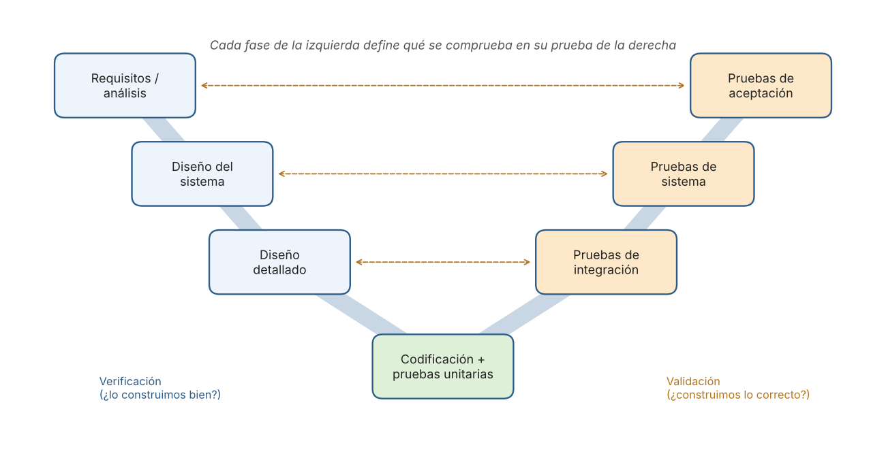
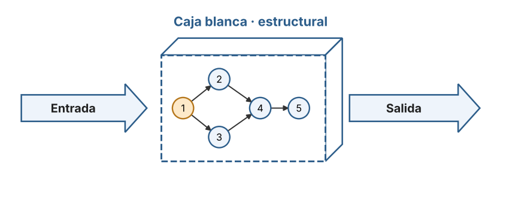
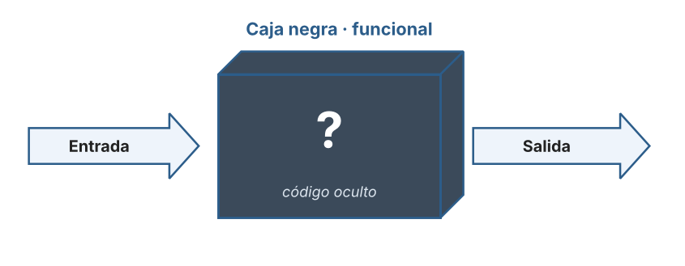
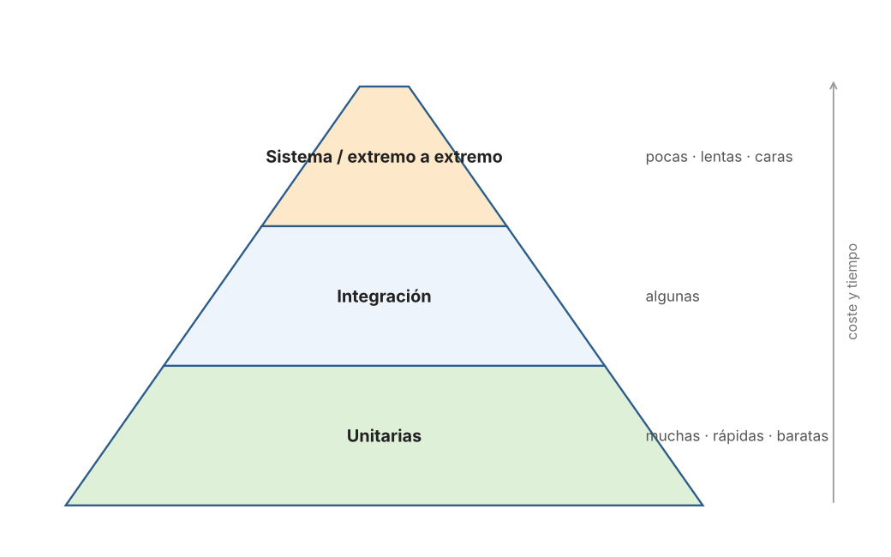
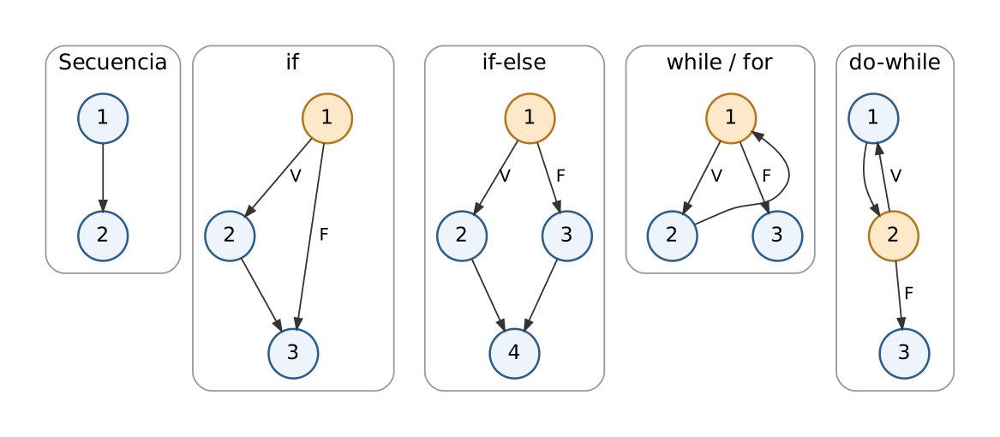
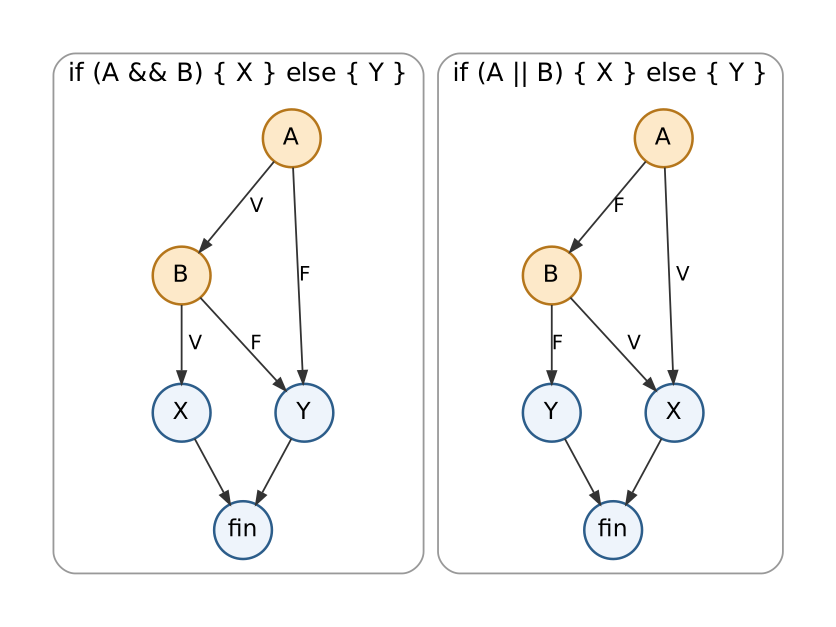
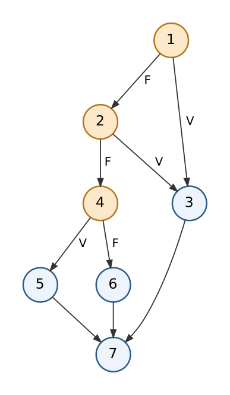
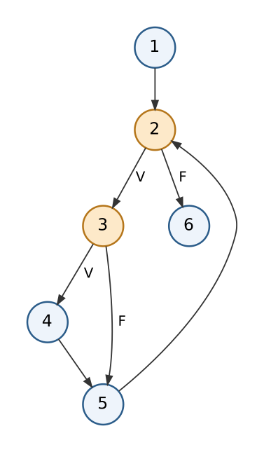
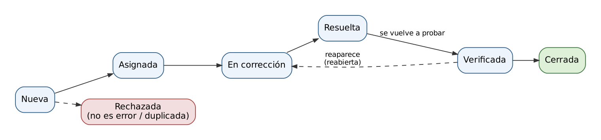

# UT 03: DISEÑO Y REALIZACIÓN DE PRUEBAS Y DEPURACIÓN

---

/// note | Qué vas a aprender en esta unidad
Esta unidad desarrolla el **RA3: Verifica el funcionamiento de programas diseñando y realizando pruebas**.

Al terminarla sabrás distinguir los tipos de pruebas, diseñar casos de prueba con técnicas de caja blanca y de caja negra, programar pruebas unitarias automáticas con **JUnit 5** y **Maven**, depurar un programa con **IntelliJ IDEA** y documentar las incidencias que encuentres.

**Conocimientos previos:** Java básico (métodos, condicionales, bucles, arrays y clases), el IDE de la UT 02 y Git básico.
///

---

## 1. ¿POR QUÉ PROBAMOS EL SOFTWARE?
*RA3 – CE a)*

Probar un programa es **ejecutarlo con la intención de encontrar errores**. Una prueba tiene éxito cuando descubre un error que aún no conocíamos, no cuando "todo sale bien".

### Error, defecto y fallo

Son tres conceptos que en el lenguaje de la calle se mezclan, pero que en ingeniería del software se distinguen:

| Concepto | Qué es | Ejemplo |
| --- | --- | --- |
| **Error** (*error*, equivocación) | Acción humana que produce un resultado incorrecto | El programador confunde `>` con `>=` |
| **Defecto** (*defect*, *bug*) | Imperfección en el código o en un documento, consecuencia del error | La línea `return edad > 18;` debería ser `return edad >= 18;` |
| **Fallo** (*failure*) | Comportamiento observable incorrecto al ejecutar el código defectuoso | La aplicación no deja votar a una persona que acaba de cumplir 18 años |

Un defecto puede pasar años sin producir ningún fallo si nadie ejecuta esa línea con los datos que lo provocan. Por eso hay que **buscarlos**.

#### Ejemplo práctico: un defecto escondido

Este método debe indicar si una persona es mayor de edad (18 años o más):

```java
public static boolean esMayorDeEdad(int edad) {
    return edad > 18;
}
```

Lo probamos con tres edades:

| Entrada | Resultado esperado | Resultado obtenido | ¿Fallo? |
| --- | --- | --- | --- |
| 17 | `false` | `false` | No |
| 30 | `true` | `true` | No |
| 18 | `true` | `false` | **Sí** |

El **defecto** está en el código desde el primer día, pero el **fallo** solo aparece con un dato concreto: la edad 18. Si nadie prueba justo ese valor, el defecto llega a producción.


### Verificación y validación

* **Verificación:** ¿estamos construyendo el producto **correctamente**? Comprueba que el software cumple su especificación.
* **Validación:** ¿estamos construyendo el producto **correcto**? Comprueba que el software hace lo que el cliente necesita de verdad.

#### Ejemplo práctico: verificado, pero no validado

Una frutería encarga un programa para cobrar. La especificación que redacta el analista dice "el precio final es el precio más el 21 % de IVA". El programador escribe:

```
FUNCIÓN calcularPrecioFinal(precio)
    DEVOLVER precio * 1.21
FIN FUNCIÓN
```

* **Verificación:** `calcularPrecioFinal(10)` devuelve `12.10`, exactamente lo que dice la especificación. ✔
* **Validación:** la fruta y la verdura llevan un IVA superreducido del 4 %, así que el programa cobra de más en casi todos los productos. El cliente no lo acepta. ✘

El código es correcto respecto a la especificación; el error estaba **en la especificación**. Por eso hacen falta las dos comprobaciones.

### Principios de las pruebas

1. **Las pruebas muestran la presencia de defectos, no su ausencia.** Que no encuentres errores no demuestra que no los haya.
2. **Las pruebas exhaustivas son imposibles.** Un método que recibe un `int` admite más de 4.000 millones de valores; hay que elegir bien qué probar.
3. **Probar pronto ahorra dinero.** Un defecto detectado en el análisis cuesta mucho menos que uno detectado en producción.
4. **Los defectos se agrupan.** Unos pocos módulos suelen concentrar la mayoría de los errores.
5. **Paradoja del pesticida.** Si repites siempre las mismas pruebas, dejan de encontrar errores nuevos; hay que revisarlas y ampliarlas.
6. **Las pruebas dependen del contexto.** No se prueba igual el software de un marcapasos que una web de recetas.
7. **La falacia de la ausencia de errores.** Un programa sin defectos que no resuelve lo que el usuario necesita sigue siendo un mal programa.

#### Ejemplo práctico: las pruebas pasan, pero el defecto sigue ahí (principio 1)

```java
public static boolean esPrimo(int n) {
    if (n < 2) {
        return false;
    }
    if (n == 2) {
        return true;
    }
    return n % 2 != 0;   // solo comprueba que el número sea impar
}
```

Si lo probamos con 1, 2, 3, 4, 5 y 7, **todas las pruebas pasan**. Pero `esPrimo(9)` devuelve `true`, y también `esPrimo(15)` y `esPrimo(21)`. Seis pruebas superadas no demostraban que el método fuera correcto: solo que no habíamos elegido el dato que lo hace fallar.

#### Ejemplo práctico: ¿y si lo probamos todo? (principio 2)

```java
public static int sumar(int a, int b) {
    return a + b;
}
```

Cada `int` puede tomar 2³² valores, así que hay 2³² × 2³² = 2⁶⁴ ≈ 1,8 · 10¹⁹ combinaciones de entrada. Aunque el ordenador ejecutara **mil millones de pruebas por segundo**, tardaría unos **585 años**. Y este es el método más sencillo que se puede escribir. Por eso, en los apartados 5 y 6, aprenderás técnicas para elegir **pocos casos que encuentren muchos errores**.

/// note | Para tu cuaderno
Escribe una versión correcta de `esPrimo` en pseudocódigo y anota qué **tres** números usarías para comprobar que ya no tiene el defecto del ejemplo.
///

Una solución en java podría ser la siguiente:

```java
import java.util.Scanner;

public class App {
    public static void main(String[] args) throws Exception {
        // Definimos variables
        int divisores = 0, numero = 0;
        Scanner teclado = new Scanner(System.in);
        
        //Leemos el numero
        System.out.println("Escribe un numero:");
        numero = teclado.nextInt();
        
        //Busco los divisores
        for (int contador = 1; contador <= numero; contador++) {
            if (numero % contador == 0) {
                divisores = divisores + 1;
            }
        }
        if (divisores == 2) {
            System.out.println(numero + " es primo");
        } else {
            System.out.println(numero + " no es primo");
        }
        teclado.close();
    }
}
```

---

## 2. LAS PRUEBAS EN EL CICLO DE VIDA DEL SOFTWARE
*RA3 – CE a)*

Las pruebas no son una fase que se hace "al final si sobra tiempo". Se **planifican desde el principio** y acompañan a todo el desarrollo. El **modelo en V** lo representa así: cada fase de diseño (izquierda) tiene asociado un nivel de prueba (derecha) que comprueba lo que esa fase definió.



### Plan de pruebas

Antes de probar se redacta un **plan de pruebas**, que recoge:

* **Qué** se va a probar (módulos, funcionalidades) y qué no.
* **Cómo**: técnicas y niveles de prueba.
* **Quién** prueba y **cuándo**.
* **Con qué**: entorno, herramientas y datos de prueba.
* **Criterios de aceptación**: cuándo damos una prueba por superada y cuándo paramos de probar.

#### Ejemplo práctico: la aplicación que calcula tu nota

Durante esta sesión y la siguiente usaremos un ejemplo que conoces bien: una aplicación que calcula la nota de cada resultado de aprendizaje (RA) de este módulo, según la programación:

* **Nota de un bloque** = 80 % teoría y prácticas + 10 % ejercicios de clase + 10 % cuaderno.
* Un **RA está superado** si todos sus bloques tienen al menos un 5.

Así se relaciona cada fase del modelo en V con su prueba:

| Fase (izquierda de la V) | Qué se define | Prueba asociada (derecha de la V) | Qué se comprueba |
| --- | --- | --- | --- |
| Requisitos | "El profesor introduce las notas y la aplicación muestra la nota de cada RA" | **Aceptación** | El profesor usa la aplicación con las notas reales de un grupo y da el visto bueno |
| Diseño del sistema | Pantalla de introducción de notas, cálculo, exportación a Moodle | **Sistema** | La aplicación completa funciona de principio a fin, también con 30 alumnos y con datos erróneos |
| Diseño detallado | Clase `Calificaciones` con los métodos `notaBloque` y `raSuperado` | **Integración** | `raSuperado` recibe bien las notas que calcula `notaBloque` |
| Codificación | El código de cada método | **Unitarias** | `notaBloque(7, 8, 6)` devuelve `7.0` |

Un **plan de pruebas** mínimo para esta aplicación:

| Apartado | Contenido |
| --- | --- |
| Qué se prueba | Cálculo de la nota de bloque, decisión de RA superado, exportación a Moodle. No se prueba el diseño gráfico. |
| Cómo | Pruebas unitarias automáticas con JUnit; pruebas de sistema manuales con las notas de un grupo ficticio |
| Quién y cuándo | El programador, las unitarias en cada cambio; el profesor, la aceptación antes de la primera evaluación |
| Con qué | IntelliJ, JUnit 5, un fichero con las notas inventadas de 30 alumnos |
| Criterio de aceptación | Todas las pruebas unitarias en verde y ninguna diferencia con el cálculo hecho a mano por el profesor |

/// note | Para tu cuaderno
Piensa en una aplicación que uses a diario (la de tu banco, la del transporte, Moodle…). Elige una funcionalidad y escribe una prueba de **cada** nivel del modelo en V: unitaria, integración, sistema y aceptación.
///

---

## 3. TIPOS DE PRUEBAS
*RA3 – CE a)*

Las pruebas se pueden clasificar según varios criterios. Una misma prueba puede ser, a la vez, unitaria, de caja negra y automática.

En todo el apartado usaremos el código de la aplicación de notas del apartado 2:

```java
public class Calificaciones {

    // Nota de un bloque: 80 % teoría y prácticas, 10 % ejercicios de clase, 10 % cuaderno
    public static double notaBloque(double teoriaPracticas, double ejerciciosClase, double cuaderno) {
        return teoriaPracticas * 0.8 + ejerciciosClase * 0.1 + cuaderno * 0.1;
    }

    // El RA está superado si todos los bloques tienen al menos un 5
    public static boolean raSuperado(double[] notasBloques) {
        for (double nota : notasBloques) {
            if (nota < 5) {
                return false;
            }
        }
        return true;
    }
}
```

### Según la técnica: caja blanca y caja negra

#### Pruebas de caja blanca (estructurales)



| Aspecto | Caja blanca |
| --- | --- |
| **Qué miramos** | **Cómo lo hace**: analizamos el código para recorrer sus caminos. |
| **Punto de partida** | El **código fuente**. |
| **Técnicas** | Cobertura, camino básico (complejidad ciclomática). |

**Ejemplo.** Miramos el código de `raSuperado`. Tiene un bucle y un `if`, así que buscamos datos que recorran cada camino:

| Entrada `raSuperado(...)` | Camino que recorre | Resultado |
| --- | --- | --- |
| `{8, 4.9}` | Entra en el bucle y el `if` es verdadero | `false` |
| `{6.2, 7.5}` | Entra en el bucle y el `if` siempre es falso | `true` |
| `{}` (sin bloques) | No entra en el bucle | `true` |

El último caso solo se nos ocurre **mirando el código**: con un array vacío, el método dice que el RA está superado sin ninguna nota. La especificación no decía nada de este caso; la caja blanca ha descubierto un hueco que hay que consultar con el cliente.

#### Pruebas de caja negra (funcionales)



| Aspecto | Caja negra |
| --- | --- |
| **Qué miramos** | Solo **qué hace** el programa: entradas y salidas. No necesitamos ver el código. |
| **Punto de partida** | La **especificación**. |
| **Técnicas** | Clases de equivalencia, valores límite. |

**Ejemplo.** Ahora, sin mirar el código, solo con la regla "80 % + 10 % + 10 %", decidimos qué probar:

| Entrada `notaBloque(teoría, clase, cuaderno)` | Resultado esperado | Por qué lo elegimos |
| --- | --- | --- |
| `(10, 10, 10)` | `10.0` | Nota máxima |
| `(7, 8, 6)` | `7.0` | Caso normal |
| `(5, 0, 0)` | `4.0` | Un 5 en el examen no basta si no hay nada más |
| `(4, 10, 10)` | `5.2` | Con un 4 en teoría se puede aprobar el bloque |

### Según el nivel

* **Pruebas unitarias:** comprueban una unidad aislada (un método o una clase). Las escribe el propio programador.
* **Pruebas de integración:** comprueban que varias unidades funcionan bien **juntas** (por ejemplo, que la clase `Carrito` usa correctamente la clase `Producto`, o que la aplicación se comunica con la base de datos).
* **Pruebas de sistema:** comprueban la aplicación completa en un entorno parecido al real, incluidos requisitos no funcionales (rendimiento, seguridad, usabilidad…).
* **Pruebas de aceptación:** las realiza o supervisa el cliente para decidir si acepta el producto. Las versiones **alfa** se prueban en la empresa que desarrolla; las **beta**, con usuarios reales en su entorno.

**Ejemplo con la aplicación de notas:**

| Nivel | Prueba concreta |
| --- | --- |
| Unitaria | `notaBloque(7, 8, 6)` devuelve `7.0` |
| Integración | Se calculan dos bloques con `notaBloque` (`5.2` y `4.0`), se pasan a `raSuperado` y devuelve `false` |
| Sistema | Se cargan las notas de 30 alumnos, se exportan a Moodle y el fichero se importa sin errores |
| Aceptación | El profesor compara los resultados de la aplicación con su hoja de cálculo y los da por buenos |

### Según el objetivo

* **Funcionales:** comprueban que el programa hace lo que dice la especificación.
* **No funcionales:** rendimiento, carga, estrés, seguridad, usabilidad, accesibilidad, compatibilidad…
* **De regresión:** se repiten tras **cualquier cambio** para comprobar que no se ha roto nada que antes funcionaba. Son el motivo principal para automatizar.
* **De humo** (*smoke tests*): una batería mínima y rápida que comprueba que lo básico arranca antes de probar a fondo.

**Ejemplo de regresión.** El curso que viene cambia la programación y el cuaderno pasa a valer un 20 %. El programador modifica `notaBloque` y vuelve a ejecutar **todas** las pruebas: las que ya existían avisan de los resultados que han cambiado, y así se comprueba que `raSuperado` sigue funcionando.

**Ejemplo de prueba de humo** (pseudocódigo de lo que se comprueba antes de nada):

```
1. ¿Arranca la aplicación?
2. ¿Se puede iniciar sesión como profesor?
3. ¿Se abre la lista de alumnos de un grupo?
4. ¿Se calcula la nota de un alumno cualquiera?
SI alguna respuesta es NO → la versión se rechaza y no se sigue probando
```

### Según la ejecución

* **Estáticas:** se revisa el código sin ejecutarlo (revisiones entre compañeros, analizadores de código como SonarLint, que verás en la UT 04).
* **Dinámicas:** se ejecuta el programa.
* **Manuales:** una persona ejecuta los pasos y comprueba el resultado.
* **Automáticas:** un programa ejecuta las pruebas y compara el resultado obtenido con el esperado. Se pueden repetir miles de veces sin coste.

**Ejemplo de prueba estática.** En una revisión de código, una compañera lee este método **sin ejecutarlo**:

```java
public static boolean esAlumno(String tipo) {
    return tipo == "ALUMNO";   // compara referencias, no el contenido del texto
}
```

y detecta que en Java los `String` se comparan con `equals`: `"ALUMNO".equals(tipo)`. El defecto se ha encontrado sin ejecutar ni una prueba.

**Ejemplo de manual frente a automática.** La misma comprobación hecha de las dos formas:

* **Manual:** ejecutas el programa, escribes 7, 8 y 6, lees en la pantalla `7.0` y lo compruebas mentalmente. Cada vez que cambies el código tendrás que repetirlo.
* **Automática:** escribes una vez esta prueba (la explicaremos en el apartado 8) y el ordenador la repite cuantas veces haga falta:

```java
@Test
void notaBloqueCasoNormal() {
    assertEquals(7.0, Calificaciones.notaBloque(7, 8, 6), 0.001);
}
```

/// tip | ¿Por qué ese `0.001`?
Prueba `Calificaciones.notaBloque(6, 5, 5)`: el resultado esperado es `5.8`, pero Java devuelve `5.800000000000001`, porque los decimales no se guardan de forma exacta en el ordenador. Por eso los `double` se comparan siempre con un pequeño margen.
///

### La pirámide de pruebas

En un proyecto sano hay **muchas pruebas unitarias** (rápidas y baratas), algunas de integración y pocas de sistema (lentas y caras de mantener).



En la aplicación de notas, la pirámide podría ser: **decenas** de pruebas unitarias de `notaBloque` y `raSuperado` (se ejecutan en milisegundos), **unas pocas** de integración entre el cálculo y la exportación a Moodle, y **una o dos** de sistema que recorren la aplicación entera.

/// note | Para tu cuaderno
Clasifica cada una de las pruebas de los ejemplos de este apartado según los cuatro criterios: técnica, nivel, objetivo y ejecución.
///

---

## 4. CASOS DE PRUEBA Y PROCEDIMIENTOS
*RA3 – CE b)*

Un **caso de prueba** es un conjunto de **entradas**, **condiciones de ejecución** y **resultado esperado** diseñado para comprobar un aspecto concreto del programa.

Un buen caso de prueba se puede repetir y su resultado esperado se decide **antes** de ejecutarlo. Si decides el resultado esperado después de ver la salida, no estás probando: estás copiando.

### Plantilla de caso de prueba

| Campo | Contenido |
| --- | --- |
| **ID** | Identificador único: `CP-01`, `CP-02`… |
| **Descripción** | Qué se comprueba: "Edad en el límite inferior de la tarifa juvenil" |
| **Precondiciones** | Estado necesario antes de empezar |
| **Entrada** | Datos concretos: `edad = 4` |
| **Resultado esperado** | `5.0` |
| **Resultado obtenido** | Se rellena al ejecutar |
| **Estado** | Superado / No superado |

Un **procedimiento de prueba** es la secuencia de pasos para ejecutar uno o varios casos de prueba: preparar el entorno, introducir los datos, ejecutar, comparar y registrar el resultado.

---

## 5. PRUEBAS DE CAJA BLANCA
*RA3 – CE b)*

En las pruebas de caja blanca **leemos el código** para diseñar casos que recorran sus distintos caminos.

### 5.1. Criterios de cobertura

La **cobertura** mide qué parte del código ejecutan nuestras pruebas. De menos a más exigente:

* **Cobertura de sentencias:** cada línea se ejecuta al menos una vez.
* **Cobertura de decisiones (ramas):** cada `if`, `while`… se evalúa al menos una vez como verdadero y otra como falso.
* **Cobertura de condiciones:** en una decisión compuesta (`a && b`), cada condición simple toma los valores verdadero y falso.
* **Cobertura de caminos:** se recorren todos los caminos posibles. Con bucles suele ser imposible, por eso usamos los **caminos independientes**.

### 5.2. La prueba del camino básico

Es la técnica de caja blanca más conocida (propuesta por Thomas McCabe). Sigue cuatro pasos:

1. Dibujar el **grafo de flujo** del método.
2. Calcular su **complejidad ciclomática** V(G).
3. Obtener un conjunto de V(G) **caminos independientes**.
4. Diseñar un **caso de prueba** que fuerce cada camino.

### 5.3. El grafo de flujo

El grafo de flujo representa el flujo de control de un método:

* **Nodo** (círculo): una o varias sentencias que se ejecutan siempre seguidas. Se numeran.
* **Nodo predicado** (en naranja en nuestros dibujos): contiene una **condición simple**; de él salen dos aristas (V y F).
* **Arista** (flecha): el paso de un nodo a otro.
* **Región**: zona del plano delimitada por aristas y nodos. **La zona exterior del grafo también cuenta como región.**

Así se representan las estructuras básicas:



Si una condición es **compuesta**, cada condición simple es un nodo predicado distinto, porque Java evalúa en cortocircuito: en `A && B`, si `A` es falsa, `B` ni se evalúa.



/// warning | Reglas para numerar los nodos
1. Las sentencias consecutivas sin saltos van en el **mismo nodo**.
2. **Cada condición simple** es un nodo predicado.
3. Cuando dos ramas se juntan (fin de un `if`) hace falta un nodo de unión; si justo después viene una sentencia, esa sentencia puede ser el nodo de unión.
4. Todos los `return` y `throw` deben llegar a un **único nodo final**. Si el método tiene varias salidas, añade un nodo "fin" al que lleguen todas.
///

### 5.4. Complejidad ciclomática

La **complejidad ciclomática V(G)** mide la complejidad lógica de un método e indica el **número de caminos independientes** que hay que probar. Se calcula de tres formas, que **deben dar el mismo resultado** (si no coinciden, revisa el grafo):

| Fórmula | Significado |
| --- | --- |
| **V(G) = número de regiones** | Contando la región exterior |
| **V(G) = A − N + 2** | A = aristas, N = nodos |
| **V(G) = P + 1** | P = nodos predicado |

Valores de referencia:

| V(G) | Riesgo |
| --- | --- |
| 1 – 10 | Método sencillo, riesgo bajo |
| 11 – 20 | Más complejo, riesgo moderado |
| 21 – 50 | Complejo, riesgo alto |
| > 50 | No se puede probar con garantías: hay que dividirlo |

Un **camino independiente** es un camino desde el nodo inicial al final que recorre **al menos una arista nueva** respecto a los caminos anteriores.

### 5.5. Ejemplo 1: clasificar una nota

```java
public static String clasificarNota(double nota) {
    String resultado;                       // 1 (junto con nota < 0)
    if (nota < 0 || nota > 10) {            // 1: nota < 0   2: nota > 10
        resultado = "Nota no válida";       // 3
    } else if (nota >= 5) {                 // 4
        resultado = "Aprobado";             // 5
    } else {
        resultado = "Suspenso";             // 6
    }
    return resultado;                       // 7
}
```



**Complejidad ciclomática**

* Aristas A = 9, nodos N = 7 → V(G) = 9 − 7 + 2 = **4**
* Nodos predicado P = 3 (nodos 1, 2 y 4) → V(G) = 3 + 1 = **4**
* Regiones = 3 interiores + 1 exterior = **4**

**Caminos independientes y casos de prueba**

| Camino | Recorrido | Entrada | Resultado esperado |
| --- | --- | --- | --- |
| C1 | 1 – 3 – 7 | nota = -1 | "Nota no válida" |
| C2 | 1 – 2 – 3 – 7 | nota = 11 | "Nota no válida" |
| C3 | 1 – 2 – 4 – 5 – 7 | nota = 7 | "Aprobado" |
| C4 | 1 – 2 – 4 – 6 – 7 | nota = 3 | "Suspenso" |

### 5.6. Ejemplo 2: un bucle

```java
public static int sumarPares(int[] numeros) {
    int suma = 0;                           // 1
    int i = 0;                              // 1
    while (i < numeros.length) {            // 2
        if (numeros[i] % 2 == 0) {          // 3
            suma += numeros[i];             // 4
        }
        i++;                                // 5
    }
    return suma;                            // 6
}
```



* A = 7, N = 6 → V(G) = 7 − 6 + 2 = **3**
* P = 2 (nodos 2 y 3) → V(G) = 2 + 1 = **3**

| Camino | Recorrido | Entrada | Resultado esperado |
| --- | --- | --- | --- |
| C1 | 1 – 2 – 6 | `{}` (vacío) | 0 |
| C2 | 1 – 2 – 3 – 4 – 5 – 2 – 6 | `{4}` | 4 |
| C3 | 1 – 2 – 3 – 5 – 2 – 6 | `{3}` | 0 |

/// tip | Caminos no factibles
A veces un camino del grafo es **imposible** de recorrer con ningún dato (por ejemplo, porque dos condiciones se contradicen). Si te pasa, indícalo y elige otro camino independiente que sí se pueda forzar.
///

/// note | Para tu cuaderno
Los grafos se dibujan **a mano**. Para cada método: código con los nodos numerados, grafo, las tres fórmulas de V(G) y la tabla de caminos y casos de prueba.
///

---

## 6. PRUEBAS DE CAJA NEGRA
*RA3 – CE b)*

Con la caja blanca te aseguras de recorrer todo el código, pero no de que el código haga lo que pide la especificación: si el programador olvidó un caso, no hay ningún camino que lo recorra, y si se equivocó en un límite, los caminos no te obligan a probar justo ese valor. Por eso la caja blanca se completa con la **caja negra**, que parte de la especificación y no del código.

Como probarlo todo es imposible, las técnicas de caja negra nos ayudan a elegir **pocos casos que encuentren muchos errores**.

### 6.1. Clases de equivalencia

Una **clase de equivalencia** es un conjunto de valores de entrada para los que el programa debería comportarse **igual**. Si un valor de la clase revela un error, cualquier otro de la misma clase probablemente también lo haría; por tanto, basta con probar **un representante** de cada clase.

Hay dos tipos:

* **Clases válidas:** valores que el programa debe aceptar.
* **Clases no válidas:** valores que debe rechazar.

Reglas prácticas para identificarlas:

| Si la condición de entrada es… | Clases válidas | Clases no válidas |
| --- | --- | --- |
| Un **rango** (de 1 a 100) | 1 (dentro del rango) | 2 (por debajo y por encima) |
| Un **valor concreto** (exactamente 8 caracteres) | 1 | 2 (menos y más) |
| Un **conjunto** de valores ("ALUMNO", "PROFESOR") | 1 por cada valor si se tratan distinto | 1 (cualquier otro valor) |
| Una **condición lógica** (debe empezar por letra) | 1 | 1 |

### 6.2. Valores límite

La experiencia dice que **los errores se esconden en los bordes**: un `<` que debía ser `<=`, un bucle que da una vuelta de más… El análisis de valores límite complementa las clases de equivalencia probando:

* El **valor exacto del límite**.
* El valor **inmediatamente anterior** y el **inmediatamente posterior**.

Para enteros, el "inmediatamente" es ±1; para importes en euros, ±0,01.

### 6.3. Ejemplo completo: precio de la entrada de cine

**Especificación:** el método `calcularPrecio(int edad)` devuelve el precio de la entrada:

* De 0 a 3 años: gratis (0 €).
* De 4 a 17 años: 5 €.
* De 18 a 64 años: 8 €.
* De 65 a 120 años: 4 €.
* Una edad menor que 0 o mayor que 120 lanza `IllegalArgumentException`.

**Paso 1. Clases de equivalencia**

| Clase | Tipo | Rango | Representante | Resultado esperado |
| --- | --- | --- | --- | --- |
| CE1 | No válida | edad < 0 | -5 | Excepción |
| CE2 | Válida | 0 ≤ edad ≤ 3 | 2 | 0 € |
| CE3 | Válida | 4 ≤ edad ≤ 17 | 10 | 5 € |
| CE4 | Válida | 18 ≤ edad ≤ 64 | 40 | 8 € |
| CE5 | Válida | 65 ≤ edad ≤ 120 | 80 | 4 € |
| CE6 | No válida | edad > 120 | 200 | Excepción |

**Paso 2. Valores límite**

| Límite | Valores a probar | Resultados esperados |
| --- | --- | --- |
| 0 | -1, 0, 1 | Excepción, 0 €, 0 € |
| 3 / 4 | 3, 4 | 0 €, 5 € |
| 17 / 18 | 17, 18 | 5 €, 8 € |
| 64 / 65 | 64, 65 | 8 €, 4 € |
| 120 | 119, 120, 121 | 4 €, 4 €, Excepción |

En el apartado 8 convertirás esta tabla en pruebas automáticas con JUnit.

/// note | Para tu cuaderno
Copia las dos tablas del ejemplo y añade una tercera columna con el **resultado obtenido** cuando ejecutes las pruebas en el ordenador. Es la forma de documentar una batería de pruebas.
///

---

## 7. MAVEN: CONSTRUCCIÓN Y PRUEBAS AUTOMÁTICAS
*RA3 – CE c), g)*

**Maven** es una herramienta de **gestión y construcción de proyectos Java**. Se encarga de:

* **Descargar las dependencias** (librerías como JUnit) desde el repositorio central.
* **Compilar**, **ejecutar las pruebas** y **empaquetar** el proyecto con un solo comando.
* Imponer una **estructura de carpetas estándar**, de modo que cualquier IDE (IntelliJ, VS Code, Eclipse…) entiende el proyecto.

### 7.1. Estructura de un proyecto Maven

```
mi-proyecto/
├── pom.xml                      ← configuración del proyecto
└── src/
    ├── main/java/               ← código de la aplicación
    │   └── es/albares/eedd/ut03/
    │       └── PrecioEntrada.java
    └── test/java/               ← código de las pruebas (mismo paquete)
        └── es/albares/eedd/ut03/
            └── PrecioEntradaTest.java
```

Las pruebas van en `src/test/java` con **el mismo paquete** que la clase que prueban. No se incluyen en el `.jar` final.

### 7.2. El fichero pom.xml

El **POM** (*Project Object Model*) describe el proyecto. Este es el que usaremos en la unidad:

```xml
<?xml version="1.0" encoding="UTF-8"?>
<project xmlns="http://maven.apache.org/POM/4.0.0"
         xmlns:xsi="http://www.w3.org/2001/XMLSchema-instance"
         xsi:schemaLocation="http://maven.apache.org/POM/4.0.0 http://maven.apache.org/xsd/maven-4.0.0.xsd">
    <modelVersion>4.0.0</modelVersion>

    <!-- Coordenadas: identifican el proyecto -->
    <groupId>es.albares.eedd</groupId>
    <artifactId>ut03-pruebas</artifactId>
    <version>1.0-SNAPSHOT</version>

    <properties>
        <maven.compiler.release>21</maven.compiler.release>
        <project.build.sourceEncoding>UTF-8</project.build.sourceEncoding>
    </properties>

    <dependencies>
        <!-- JUnit 5: solo se usa para las pruebas (scope test) -->
        <dependency>
            <groupId>org.junit.jupiter</groupId>
            <artifactId>junit-jupiter</artifactId>
            <version>5.13.4</version>
            <scope>test</scope>
        </dependency>
    </dependencies>

    <build>
        <plugins>
            <!-- Surefire: el plugin que ejecuta las pruebas en la fase test -->
            <plugin>
                <groupId>org.apache.maven.plugins</groupId>
                <artifactId>maven-surefire-plugin</artifactId>
                <version>3.5.3</version>
            </plugin>
        </plugins>
    </build>
</project>
```

* **`groupId`**: organización (dominio al revés). **`artifactId`**: nombre del proyecto. **`version`**: versión; `SNAPSHOT` significa "en desarrollo".
* **`dependencies`**: librerías que necesita el proyecto. Maven las descarga solo.
* **`scope test`**: la dependencia solo está disponible para el código de `src/test`.

### 7.3. Ciclo de vida

Maven organiza la construcción en **fases**. Al pedir una fase, se ejecutan también todas las anteriores:

| Fase | Qué hace |
| --- | --- |
| `validate` | Comprueba que el proyecto es correcto |
| `compile` | Compila `src/main/java` |
| `test` | Compila `src/test/java` y **ejecuta las pruebas** |
| `package` | Genera el `.jar` (solo si las pruebas pasan) |
| `install` | Copia el `.jar` en tu repositorio local (`~/.m2`) |

Comandos útiles en la terminal (dentro de la carpeta del proyecto):

```bash
mvn test                              # compila y ejecuta todas las pruebas
mvn test -Dtest=PrecioEntradaTest     # ejecuta solo una clase de prueba
mvn clean package                     # borra target/, prueba y empaqueta
```

Esto es lo que convierte las pruebas en **automáticas**: cualquiera puede ejecutar toda la batería con un comando, y si una falla, **el proyecto no se empaqueta**.

### 7.4. Proyecto Maven en IntelliJ IDEA

1. **File → New → Project…**
2. Elige **Java**, escribe el nombre (`ut03-pruebas`) y en **Build system** marca **Maven**.
3. En **JDK** selecciona el 21. Despliega **Advanced Settings** y escribe el **GroupId** (`es.albares.eedd`).
4. Pulsa **Create**. IntelliJ genera el `pom.xml` y las carpetas `src/main/java` y `src/test/java`.
5. Añade la dependencia de JUnit al `pom.xml` y pulsa el icono **Load Maven Changes** (o ++ctrl+shift+o++).

IntelliJ incluye la ventana **Maven** (a la derecha), desde la que puedes lanzar cualquier fase con doble clic en *Lifecycle → test*.

/// details | ¿Y si no tienes Maven instalado en la terminal?
IntelliJ trae Maven integrado (*bundled*), así que desde el IDE funciona igual. Para usar `mvn` en la terminal de Xubuntu: `sudo apt install maven`. En Windows, descarga Maven desde la web oficial, descomprímelo y añade su carpeta `bin` al `PATH`.
///

---

## 8. PRUEBAS UNITARIAS CON JUNIT 5
*RA3 – CE c), f), g)*

**JUnit** es el *framework* estándar de pruebas unitarias en Java. Una prueba es un **método de una clase de prueba** que llama al código y **comprueba el resultado con una aserción**.

### 8.1. Mi primera prueba

```java
package es.albares.eedd.ut03;

import org.junit.jupiter.api.DisplayName;
import org.junit.jupiter.api.Test;

import static org.junit.jupiter.api.Assertions.*;

class PrecioEntradaTest {

    @Test
    @DisplayName("Un adulto de 30 años paga 8 €")
    void adultoPagaOcho() {
        // Preparar (Arrange)
        int edad = 30;
        // Actuar (Act)
        double precio = PrecioEntrada.calcularPrecio(edad);
        // Comprobar (Assert)
        assertEquals(8.0, precio, 0.001);
    }
}
```

Cada prueba sigue el patrón **AAA**: **preparar** los datos, **actuar** (llamar al método) y **comprobar** el resultado.

/// tip | Crear la clase de prueba en IntelliJ
Sitúate en el nombre de la clase que quieres probar y pulsa ++ctrl+shift+t++ (*Navigate → Test*) → **Create New Test…**. Elige **JUnit5** y marca los métodos. IntelliJ crea la clase en `src/test/java` con el paquete correcto.
///

### 8.2. Anotaciones principales

| Anotación | Uso |
| --- | --- |
| `@Test` | Marca un método como prueba |
| `@DisplayName("…")` | Nombre legible que aparece en el informe |
| `@BeforeEach` / `@AfterEach` | Se ejecuta antes / después de **cada** prueba (preparar o limpiar objetos) |
| `@BeforeAll` / `@AfterAll` | Se ejecuta una sola vez antes / después de todas (método `static`) |
| `@Disabled("motivo")` | Desactiva temporalmente una prueba |
| `@ParameterizedTest` | Prueba que se repite con distintos datos |
| `@CsvSource`, `@ValueSource` | Proporcionan los datos de una prueba parametrizada |

### 8.3. Aserciones

Todas están en `org.junit.jupiter.api.Assertions`. Si una aserción no se cumple, la prueba **falla** y JUnit muestra el valor esperado y el obtenido.

| Aserción | Comprueba que… |
| --- | --- |
| `assertEquals(esperado, real)` | son iguales. Con `double`, añade un margen: `assertEquals(8.0, real, 0.001)` |
| `assertNotEquals(a, b)` | son distintos |
| `assertTrue(cond)` / `assertFalse(cond)` | la condición es verdadera / falsa |
| `assertNull(obj)` / `assertNotNull(obj)` | el objeto es / no es `null` |
| `assertArrayEquals(esp, real)` | dos arrays tienen el mismo contenido |
| `assertThrows(Excepcion.class, () -> …)` | el código lanza esa excepción |
| `assertAll(() -> …, () -> …)` | ejecuta varias aserciones y muestra **todos** los fallos juntos |

/// warning | Cuidado con el orden y con los `double`
En `assertEquals` el **primer** parámetro es el valor **esperado** y el segundo el **obtenido**. Si los inviertes, el mensaje de error te confundirá.

Nunca compares `double` sin margen: `0.1 + 0.2` no es exactamente `0.3` en coma flotante.
///

### 8.4. Probar excepciones

```java
@Test
void edadNegativaLanzaExcepcion() {
    IllegalArgumentException ex = assertThrows(IllegalArgumentException.class,
            () -> PrecioEntrada.calcularPrecio(-1));
    assertTrue(ex.getMessage().contains("-1"));
}
```

El código que debe fallar va dentro de una **expresión lambda** `() -> …` para que JUnit pueda capturar la excepción.

### 8.5. Pruebas parametrizadas

Cuando tienes una tabla de casos de prueba (como la de clases de equivalencia y valores límite), no escribas un método por fila: usa una **prueba parametrizada**.

```java
@ParameterizedTest(name = "edad {0} → {1} €")
@CsvSource({
    "0, 0.0", "3, 0.0",
    "4, 5.0", "17, 5.0",
    "18, 8.0", "64, 8.0",
    "65, 4.0", "120, 4.0"
})
void precioSegunEdad(int edad, double esperado) {
    assertEquals(esperado, PrecioEntrada.calcularPrecio(edad), 0.001);
}

@ParameterizedTest
@ValueSource(ints = {-1, 121})
void edadNoValidaLanzaExcepcion(int edad) {
    assertThrows(IllegalArgumentException.class,
            () -> PrecioEntrada.calcularPrecio(edad));
}
```

* `@CsvSource`: cada cadena es una ejecución; los valores separados por comas se asignan a los parámetros en orden. Las cadenas de texto con espacios se escriben entre comillas simples: `"'hola que tal', 3"`.
* `@ValueSource`: un solo parámetro; admite `ints`, `doubles`, `strings`…

### 8.6. Ejecutar las pruebas

* **Desde el editor:** icono ▶ verde junto a la clase o al método de prueba.
* **Todas las pruebas:** clic derecho sobre `src/test/java` → **Run 'All Tests'**.
* **Desde Maven:** ventana Maven → *Lifecycle* → `test`, o `mvn test` en la terminal.

La ventana **Run** muestra un árbol con cada prueba: ✔ verde si pasa y ✘ rojo si falla, con el mensaje `expected: <8.0> but was: <5.0>`.

### 8.7. Cobertura de código

IntelliJ mide la cobertura: clic derecho sobre la clase de prueba → **More Run/Debug → Run '…' with Coverage**. El editor colorea el margen de cada línea:

* **Verde:** línea ejecutada por las pruebas.
* **Amarillo:** ejecutada parcialmente (alguna rama de la condición no se ha probado).
* **Rojo:** ninguna prueba ha pasado por ella.

Si has diseñado bien los casos con el camino básico, debes tener todas las líneas en verde.

### 8.8. Buenas prácticas

* **Una prueba, un comportamiento.** Si falla, el nombre debe decirte qué se ha roto.
* **Nombres descriptivos:** `dividirEntreCeroLanzaExcepcion` mejor que `test3`.
* **Pruebas independientes:** el resultado no debe depender del orden en que se ejecutan.
* **Rápidas y repetibles:** sin depender de la hora, de Internet o de datos aleatorios.
* **Ejecuta las pruebas antes de cada `commit`.** Si una falla, no subas el cambio.

/// details | ¿Y en Python? pytest
Si un ejercicio es en Python, el equivalente a JUnit es **pytest**. Las pruebas son funciones que empiezan por `test_` dentro de ficheros `test_*.py`, y se usa `assert` directamente:

```python
# test_precio.py
import pytest
from precio import calcular_precio

def test_adulto_paga_ocho():
    assert calcular_precio(30) == 8.0

@pytest.mark.parametrize("edad, esperado", [(0, 0.0), (4, 5.0), (18, 8.0), (65, 4.0)])
def test_precio_segun_edad(edad, esperado):
    assert calcular_precio(edad) == pytest.approx(esperado)

def test_edad_negativa():
    with pytest.raises(ValueError):
        calcular_precio(-1)
```

Se instala con `pip install pytest` (dentro de un entorno virtual) y se ejecuta con `pytest` en la carpeta del proyecto.
///

---

## 9. AUTOMATIZACIÓN, INTEGRACIÓN Y REGRESIÓN
*RA3 – CE g)*

### Pruebas automáticas e integración continua

Una vez escritas, las pruebas JUnit son **automáticas**: `mvn test` ejecuta cientos de ellas en segundos. El siguiente paso es que se ejecuten **solas cada vez que alguien sube código** al repositorio. Eso se llama **integración continua** (CI).

Con GitHub basta con añadir al repositorio el fichero `.github/workflows/pruebas.yml`:

```yaml
name: Pruebas
on: [push, pull_request]
jobs:
  test:
    runs-on: ubuntu-latest
    steps:
      - uses: actions/checkout@v4
      - uses: actions/setup-java@v4
        with:
          distribution: temurin
          java-version: '21'
      - run: mvn -B test
```

En cada `push`, GitHub compila el proyecto y ejecuta las pruebas. En la pestaña **Actions** verás un ✔ verde o un ✘ rojo junto a cada commit.

### Pruebas de regresión

Cuando corriges un error, **escribe primero una prueba que lo reproduzca** (fallará) y luego corrige el código (pasará). Esa prueba se queda en el proyecto para siempre: si alguien vuelve a introducir el mismo error, la prueba lo detectará. Así se construye la batería de regresión.

### Pruebas de integración

Comprueban que varias clases colaboran correctamente. Con JUnit se escriben igual que las unitarias, pero usando objetos reales de varias clases:

```java
@Test
void totalDelCarritoSumaLosProductos() {
    Carrito carrito = new Carrito();
    carrito.anadir(new Producto("Teclado", 25.0), 2);
    carrito.anadir(new Producto("Ratón", 10.0), 1);
    assertEquals(60.0, carrito.total(), 0.001);
}
```

Si una de las clases todavía no existe o depende de algo externo (una base de datos, un servicio web), se sustituye por un **doble de prueba**: un objeto falso que responde lo que necesitamos. Lo verás en cursos posteriores.

---

## 10. DEPURACIÓN DE PROGRAMAS
*RA3 – CE c), d), e)*

Las pruebas nos dicen **que** hay un error; la **depuración** nos ayuda a encontrar **dónde** está y **por qué** ocurre. Consiste en ejecutar el programa de forma controlada, pararlo en puntos concretos e inspeccionar su estado.

### 10.1. Herramientas de depuración del IDE

Todos los IDE modernos incluyen un **depurador** (*debugger*). En IntelliJ:

* Se inicia con el icono del bicho 🐞, con ++shift+f9++, o desde el ▶ del margen → **Debug**.
* También puedes depurar una **prueba JUnit** que falla: clic derecho sobre la prueba → **Debug**.
* Se abre la ventana **Debug** con: la **barra de control**, el panel de **Frames** (pila de llamadas), el panel de **Variables**, las **Watches** (expresiones vigiladas) y la **Consola**.

### 10.2. Puntos de ruptura (*breakpoints*)

Un **punto de ruptura** detiene la ejecución **justo antes** de ejecutar una línea, para que puedas observar el estado del programa.

| Tipo | Cómo se crea en IntelliJ | Cuándo se usa |
| --- | --- | --- |
| **De línea** | Clic en el margen izquierdo de la línea o ++ctrl+f8++ (círculo rojo) | Parar siempre en esa línea |
| **Condicional** | Clic derecho sobre el punto → escribe la *Condition* (`i == 17`) | Parar solo cuando ocurre algo concreto, por ejemplo en la vuelta 17 de un bucle |
| **De registro** (*logging*) | Clic derecho → desmarca *Suspend* y marca *Evaluate and log* | Escribir un valor en la consola sin parar el programa ni llenar el código de `println` |
| **De método** | Clic en el margen de la línea de cabecera del método (rombo) | Parar al entrar o salir de un método |
| **De campo** (*field watchpoint*) | Clic en el margen de la declaración de un atributo (ojo) | Parar cuando alguien lee o modifica ese atributo |
| **De excepción** | *Run → View Breakpoints* (++ctrl+shift+f8++) → + → *Java Exception Breakpoints* | Parar en el momento en que se lanza una excepción (por ejemplo `NullPointerException`) |

En *Run → View Breakpoints* ves todos los puntos de ruptura del proyecto, puedes desactivarlos sin borrarlos y cambiar sus propiedades.

### 10.3. Seguimiento paso a paso

Con el programa detenido, la barra de control permite avanzar:

| Acción | Tecla | Qué hace |
| --- | --- | --- |
| **Step Over** | ++f8++ | Ejecuta la línea actual y para en la siguiente. Si hay una llamada a un método, la ejecuta entera sin entrar |
| **Step Into** | ++f7++ | Si la línea llama a un método, **entra** en él |
| **Smart Step Into** | ++shift+f7++ | Si la línea tiene varias llamadas, te deja elegir en cuál entrar |
| **Step Out** | ++shift+f8++ | Termina el método actual y vuelve al que lo llamó |
| **Run to Cursor** | ++alt+f9++ | Continúa hasta la línea donde está el cursor |
| **Resume** | ++f9++ | Continúa hasta el siguiente punto de ruptura |
| **Stop** | ++ctrl+f2++ | Detiene la ejecución |

Los atajos son los del mapa de teclado de Windows/Linux; en macOS cambian (consúltalos en *Settings → Keymap*).

### 10.4. Examinar y modificar variables

* **Variables:** muestra las variables locales, los parámetros y los atributos del objeto actual (`this`). Los valores que acaban de cambiar aparecen resaltados. IntelliJ también los escribe en gris al final de cada línea del editor.
* **Watches:** expresiones que quieres vigilar todo el rato, por ejemplo `suma / i` o `notas[i] >= 5`. Se añaden con el botón **+** del panel.
* **Evaluate Expression** (++alt+f8++): evalúa **cualquier expresión Java** con el estado actual: `notas.length`, `calificacion(9.0)`, `Math.max(a, b)`…
* **Set Value** (++f2++ sobre una variable en el panel Variables): **cambia el valor de una variable en plena ejecución**. Sirve para comprobar hipótesis ("¿y si `i` valiera 0?") o para forzar una rama del código sin modificar el programa ni reiniciarlo.
* **Frames:** la pila de llamadas. Al hacer clic en un nivel anterior ves las variables del método que hizo la llamada.

### 10.5. Ejemplo de depuración

Este método debería calcular la media de un array, pero `media(new int[]{4, 6, 7, 5})` devuelve `4.0` en lugar de `5.5`:

```java
public static double media(int[] datos) {
    int suma = 0;
    for (int i = 1; i < datos.length; i++) {
        suma += datos[i];
    }
    return suma / datos.length;
}
```

1. Pon un punto de ruptura en `suma += datos[i];` y lanza el programa en modo depuración.
2. En la primera parada, el panel Variables muestra `i = 1`: **el bucle se ha saltado el primer elemento** (`datos[0] = 4`). Primer defecto encontrado.
3. Añade una *watch* con `suma` y avanza con ++f9++ hasta salir del bucle: `suma = 18` (6 + 7 + 5).
4. Para en `return` y abre **Evaluate Expression** con `suma / datos.length`: el resultado es `4`, un **entero**. La división entre dos `int` descarta los decimales. Segundo defecto.
5. Prueba la hipótesis sin reiniciar: con **Set Value** cambia `suma` a `22` y evalúa `(double) suma / datos.length` → `5.5`. 
6. Corrige: el bucle empieza en `i = 0` y la división es `(double) suma / datos.length`. Escribe una prueba de regresión con `{4, 6, 7, 5}` → `5.5`.

/// note | Para tu cuaderno
Anota en tu cuaderno una tabla con las teclas de depuración y, para cada error que depures en clase, una **traza**: valores de las variables en cada parada del depurador.
///

---

## 11. DOCUMENTACIÓN DE INCIDENCIAS
*RA3 – CE h)*

Cuando una prueba falla o el depurador revela un defecto, hay que **registrarlo** para que quede constancia, alguien lo corrija y luego se compruebe la corrección. Ese registro es una **incidencia** (*issue*, *bug report*).

### Contenido de un informe de incidencia

| Campo | Descripción |
| --- | --- |
| **ID y título** | Breve y concreto: "La media ignora la primera nota del array" |
| **Fecha y autor** | Quién la detecta y cuándo |
| **Entorno** | Versión del programa, sistema operativo, versión de Java |
| **Pasos para reproducirla** | Lista numerada y exacta. Si otra persona no puede reproducirla, no se podrá corregir |
| **Resultado esperado** | Lo que dice la especificación |
| **Resultado obtenido** | Lo que pasa realmente (mensaje de error, valor…) |
| **Gravedad** | Impacto en el sistema: crítica, alta, media, baja |
| **Prioridad** | Urgencia de la corrección: alta, media, baja |
| **Evidencias** | Capturas, trazas de la consola, la prueba JUnit que falla |
| **Estado** | Situación en su ciclo de vida |

Gravedad y prioridad no son lo mismo: una falta de ortografía en la portada tiene gravedad **baja** pero puede tener prioridad **alta**.

### Ciclo de vida de una incidencia



### Herramientas

En la empresa se usan gestores como **Jira**, **Redmine**, **Bugzilla** o **GitHub Issues**. En GitHub, cada repositorio tiene una pestaña **Issues**: creas la incidencia, le asignas etiquetas (`bug`, `enhancement`…) y, si en el mensaje de un commit escribes `Fixes #3`, la incidencia número 3 se cierra automáticamente al llegar ese commit a la rama principal.

---

## 12. NORMAS DE CALIDAD
*RA3 – CE a)*

Las pruebas son una parte del **aseguramiento de la calidad** del software. Existen normas internacionales que definen qué es la calidad y cómo se prueba:

* **ISO/IEC 25010** (dentro de la familia **ISO/IEC 25000, SQuaRE**): define el modelo de **calidad del producto software**. Su revisión de 2023 recoge nueve características: adecuación funcional, eficiencia de desempeño, compatibilidad, capacidad de interacción (antes "usabilidad"), fiabilidad, seguridad, mantenibilidad, flexibilidad (antes "portabilidad") y protección (*safety*).
* **ISO/IEC/IEEE 29119**: norma específica de **pruebas de software**. Define conceptos, procesos, documentación (plan de pruebas, especificación de casos, informes de incidencias) y técnicas.
* **ISTQB** (*International Software Testing Qualifications Board*): no es una norma sino una **certificación profesional** de *testers* muy reconocida. Los siete principios del apartado 1 vienen de su temario.

En el día a día, la calidad también depende de **buenas prácticas** del equipo: seguir una guía de estilo, revisar el código entre compañeros, mantener una batería de pruebas automáticas y no subir código que rompa las pruebas.

---

## RESUMEN

* Probar es buscar errores. Las pruebas exhaustivas son imposibles: hay que diseñar casos con técnica.
* **Caja blanca:** grafo de flujo → V(G) (regiones = A − N + 2 = P + 1) → caminos independientes → casos de prueba.
* **Caja negra:** clases de equivalencia + valores límite, a partir de la especificación.
* **JUnit 5 + Maven:** pruebas unitarias automáticas, `@Test`, `@ParameterizedTest`, `assertEquals`, `assertThrows`, `mvn test`.
* **Depuración:** puntos de ruptura (también condicionales), paso a paso, Variables, Watches, Evaluate Expression y Set Value.
* **Incidencias:** se documentan con pasos para reproducirlas, resultado esperado y obtenido, gravedad y prioridad.
